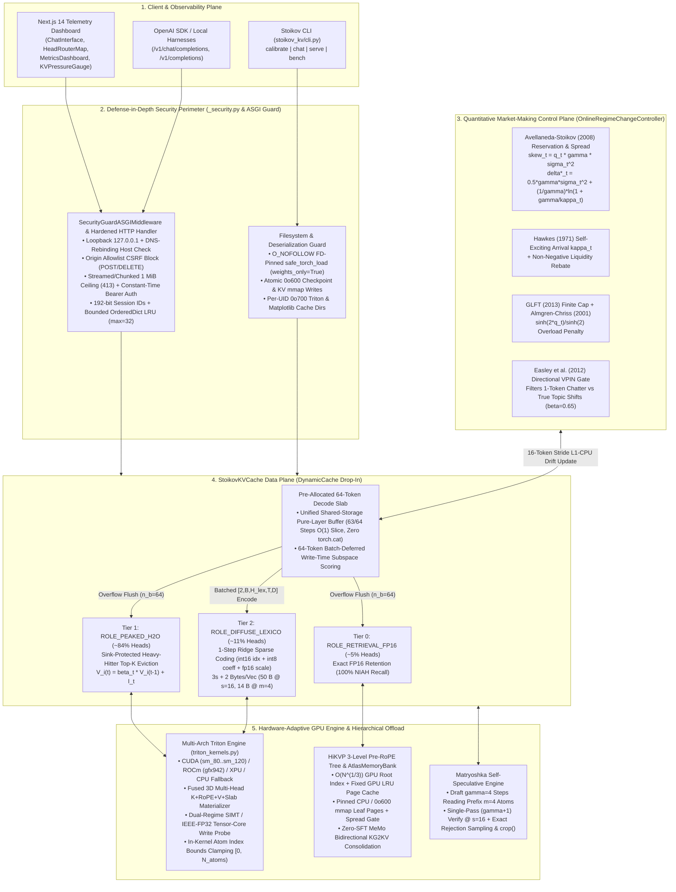
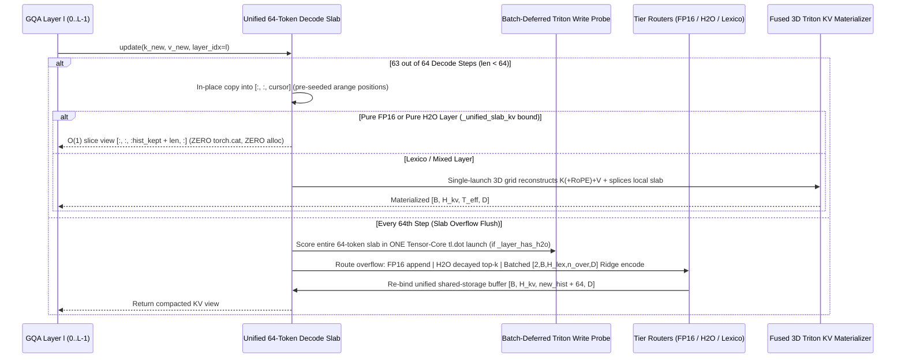
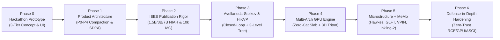

# StoikovKV — Complete System Architecture, Project Evolution & Empirical Numbers

> **Quick Links:** [Repository Root (`README.md`)](../README.md) | [Benchmark Numbers (`01_BENCHMARK_NUMBERS.md`)](./benchmarks/01_BENCHMARK_NUMBERS.md) | [Benchmark Theory (`02_BENCHMARK_THEORY_AND_INTERPRETATION.md`)](./benchmarks/02_BENCHMARK_THEORY_AND_INTERPRETATION.md)

---

## Part I — Detailed System Architecture

**StoikovKV** treats Transformer KV-cache management as a **closed-loop high-frequency market-making and hierarchical storage problem**. Instead of applying a uniform compression heuristic to every attention head (which either destroys exact passkey recall under heavy-hitter eviction or wastes HBM bandwidth reconstructing peaked heads from dictionaries), StoikovKV decomposes KV caching into **seven tightly integrated subsystems**:

1. **Offline Streaming Subspace, Role & Dictionary Calibration** (`src/stoikov_kv/calibration.py`)
2. **Online Quantitative Microstructure Regime & Inventory Controller** (`OnlineRegimeChangeController` in `src/stoikov_kv/cache.py`)
3. **3-Tier Shared-Storage In-Place Hybrid KV Cache** (`StoikovKVCache` in `src/stoikov_kv/cache.py`)
4. **1-Step ElasticNet Sparse Codec & Multi-Architecture GPU Kernel Engine** (`src/stoikov_kv/elastic_lexico.py`, `src/stoikov_kv/triton_kernels.py`)
5. **3-Level Sublinear Offloaded `HiKVP` & Bidirectional `AtlasMemoryBank`** (`src/stoikov_kv/hikvp.py`, `src/stoikov_kv/atlas_memory.py`)
6. **Single-Pass Matryoshka Self-Speculative Decoding** (`src/stoikov_kv/matryoshka_spec.py`)
7. **Defense-in-Depth Security & Serving Stack** (`src/stoikov_kv/_security.py`, `src/stoikov_kv/server.py`, `src/stoikov_kv/cli.py`, `server/`, `frontend/`)

---

### 1. End-to-End Topological Architecture Diagram

---

### 2. Deep Dive by Architectural Subsystem

#### 2.1 Offline Streaming Calibration (`src/stoikov_kv/calibration.py`)
Runs in a single offline pass (`~8.9s` for 1.5B, `~15.6s` for 3B on an 8 GB GPU) with **`output_attentions=False`** ($O(B \cdot T)$ hook memory, avoiding $O(T^2)$ attention matrix OOMs) and supports both standard HuggingFace CausalLMs (`model.layers`) and nested multimodal/looped configurations (`config.text_config`, `model.llm.layers`):
- **Regularized Sign-Aligned Query Subspace ($U_Q$)**: Accumulates uncentered query Gram matrices $G_{l,h} = \frac{1}{M} Q^\top Q + 0.1 I_d \in \mathbb{R}^{d \times d}$ in FP64 across GQA query groups ($q_{\text{per\_kv}} = H_q / H_{kv}$), extracts top-$r$ ($r = 16$) orthonormal eigenvectors $U_Q \in \mathbb{R}^{L \times H_{kv} \times d \times r}$, and sign-aligns columns so $\bar{Q} U_Q \ge 0$.
- **Attention-Free Write-Time Subspace Probe ($I_t$)**: Scores incoming KV tokens at write time without future queries:
  $$I_t = \operatorname{softplus}\!\big((K_t U_Q)_0\big) \cdot \Big(1 + 0.25\,\|\operatorname{ReLU}(K_t U_Q)\|_2\Big) \cdot \sqrt{\max(\|V_t\|_2, 10^{-6})} + B_{\text{sink}}\,\mathbb{I}[t < 4]$$
  Achieves Spearman $\rho = 0.5733 \pm 0.2716$ (`52.19%` Recall@20%) on real `Qwen2.5-1.5B` held-out prompts versus $-0.0354$ for $\|V_t\|_2$ alone.
- **Disjoint 3-Tier Head Routing**: Evaluates held-out needle copy selectivity and normalized Shannon entropy per KV head:
  - `ROLE_RETRIEVAL_FP16 (0)` (`~5%` heads): Highest needle-selectivity heads kept lossless in FP16 (or offloaded losslessly via `HiKVP`).
  - `ROLE_PEAKED_H2O (1)` (`~84%` heads): Low-entropy concentrated heads routed to decayed heavy-hitter eviction; co-locates non-retrieval layers into **layer-pure H2O** (`25/28` layers on Qwen2.5) so pure layers execute unified shared-storage slab slicing.
  - `ROLE_DIFFUSE_LEXICO (2)` (`~11%` heads): High-entropy diffuse heads routed to sparse dictionary coding.
- **Pre-RoPE Overcomplete Dictionary & FP64 Ridge Preconditioner**: Trains unit-column dictionaries $D \in \mathbb{R}^{L \times d \times N}$ on pre-RoPE $K$ and $V$ vectors so rotational phase variance is factored out before sparse coding, then solves $W_{\text{ridge}} = (D^\top D + \lambda_2 I_N)^{-1} D^\top$ in FP64 (`relative residual < 7.5e-16`).

---

#### 2.2 Quantitative Market-Making Control Plane (`OnlineRegimeChangeController` in `src/stoikov_kv/cache.py`)
Maps limit-order-book market-making stochastic optimal control directly onto GPU HBM KV inventory management:

| Quantitative Finance Model | Equation in StoikovKV | Systems Engineering Role |
| :--- | :--- | :--- |
| **Avellaneda–Stoikov (2008) Inventory & Spread** | $q_t = \text{clip}\!\left(\frac{N_{\text{seq}} - N_{\text{target}}}{N_{\text{target}}}, -1, 1\right)$, $\text{skew}_t = q_t \gamma \sigma_t^2$, $\delta_t^* = \frac{1}{2}\gamma\sigma_t^2 + \frac{1}{\gamma}\ln\!\left(1 + \frac{\gamma}{\kappa_t}\right)$ | Relaxes `keep_ratio` when VRAM inventory is negative ($q_t < 0$, boosting 7B multi-fact QA `3.5x`: `12.5% -> 43.8%`) and tightens retention as $q_t \to +1$. |
| **Hawkes (1971) Self-Exciting Arrival ($\kappa_t$)** | $\kappa_t = \kappa_0 + \alpha_H \sum_{s < t} e^{-\beta_H (t-s)}\mathbb{I}[z_s > \tau_{\text{jump}}]$, $\Delta\delta_t = \delta^*(\sigma_t^2, \kappa_0) - \delta^*(\sigma_t^2, \kappa_t) \ge 0$ | Detects clustered high-novelty reasoning bursts, granting a **non-negative liquidity rebate** to retain co-occurring facts (`cache.py` & `hikvp.py`) before decaying back to $\kappa_0 = 1.5$. |
| **GLFT (2013) + Almgren–Chriss (2001) Overload Skew** | $\text{overload}_t = \gamma_{\text{AC}}\frac{\sinh(2 q_t)}{\sinh(2)}\mathbb{I}[q_t > 0]$ + terminal cap `max_h2o_tokens` | Prevents unbounded KV growth during ultra-low-volatility ($\sigma_t^2 \to 0$) repetitive log streams where classic $q_t \sigma_t^2$ skew vanishes. |
| **Easley–López de Prado–O'Hara (2012) VPIN Gate** | $\text{VPIN}_t = \frac{\|\bar{\Delta u}_t\|_2}{\overline{\|\Delta u_t\|_2} + \epsilon} \in [0, 1]$ | Distinguishes symmetric 1-token lexical/punctuation chatter (low VPIN -> preserve $\beta_{\text{stat}} = 0.99$) from aligned directional topic shifts (high VPIN + $z_t > \tau_z$ -> fire $\beta_{\text{shift}} = 0.65$ to flush stale Turn-1 heavy hitters). |

To avoid `cudaStreamSynchronize()` pipeline bubbles, Layer 0 samples query-subspace energy on a **16-token stride** and transfers a single 64-float vector to L1 CPU cache (`0` per-token `.item()` stalls).

---

#### 2.3 In-Place Hybrid Data Plane & Batch-Deferred Scoring (`StoikovKVCache` in `src/stoikov_kv/cache.py`)
Subclasses `transformers.cache_utils.DynamicCache` for drop-in `model.generate(..., past_key_values=cache)` compatibility while maintaining **`physical_resident_bytes == compressed_bytes`** (zero duplicate base-class KV tensors):

---

#### 2.4 1-Step Sparse Dictionary Codec & Multi-Architecture GPU Engine (`elastic_lexico.py`, `triton_kernels.py`)
- **1-Step ElasticNet Ridge Encoder (`ElasticLexicoCodec.encode`)**:
  Computes $Z = \hat{X} W_{\text{ridge}}^\top$, applies soft-thresholding $\mathcal{S}_{\lambda_1}(Z)$, selects top-$s$ magnitude-sorted atoms $|y_{(1)}| \ge \dots \ge |y_{(s)}|$, rescales energy to match $\|\hat{X}\|_2$, and quantizes coefficients to symmetric `int8` + per-vector `fp16` scale (`QuantizedInt8Values`). Payload is **`3s + 2` bytes/vector** (`50 B` at $s=16$ vs `256 B` FP16 = `5.12x` compression; `14 B` at $m=4$ = `18.29x` bandwidth compression).
- **Hardware-Adaptive Multi-Backend Kernel Engine (`triton_kernels.py`)**:
  - Dynamically detects GPU backend (`cuda`, `hip`, `xpu`, `mps`/`cpu` fallback) via `detect_gpu_profile` and selects architecture-tuned tile geometry (`BLOCK_N`), `num_warps`, software pipeline `num_stages`, L2 cache residency hints (`evict_last` on dictionary $D$, `evict_first` on streaming sparse indices), AMD CDNA3 `waves_per_eu=2` (`warp_size=64`), and Intel Xe `grf_mode='large'`, while distinguishing **Datacenter Blackwell (`sm_100` B200: 227 KB SRAM, TMA + TMEM)** from **Consumer Blackwell (`sm_120` RTX 5090: 128 KB SRAM, TMA, no TMEM)**.
  - **Three Fused Kernels**:
    1. `triton_lexico_reconstruct`: Direct register-tiled reconstruction + half-split RoPE (`26.20x` faster at 16K, `33.5x` less temporary VRAM).
    2. `triton_fused_kv_lexico_materialize`: 3D launch `(tiles_t, B * H_lex, 2)` reconstructing all Lexico heads' historical `K` (+ RoPE) and `V` + splicing active local slab into contiguous or strided mixed-layer output views (`7.57x` faster, `0.0` error).
    3. `triton_fused_write_probe`: Dual-regime (`SIMT` for $T < 16$, IEEE-FP32 Tensor-Core `tl.dot` for $T \ge 16$) write-time subspace scorer (`288.85x` faster combined with 64-token batch deferral).
  - **In-Kernel Memory Safety**: Every sparse atom gather enforces `valid_atom = (atom_idx >= 0) & (atom_idx < n_atoms)` clamping + zero-coefficient masking in registers (`0.000 ms` overhead), preventing GPU HBM OOB reads or sticky `CUDA_ERROR_ILLEGAL_ADDRESS` crashes on malformed inputs.

---

#### 2.5 3-Level Offloaded `HiKVP` & `AtlasMemoryBank` (`hikvp.py`, `atlas_memory.py`)
- **`HiKVPStore` (`hikvp.py`)**: Stores pre-RoPE leaf pages (`page_size = 64`) in pinned host RAM or atomic `0o600` NVMe `mmap` files under a 3-level balanced B-tree hierarchy (`Root -> Internal -> Leaf`). Only $O(N^{1/3})$ root centroids/bounding boxes and a fixed-capacity `GPULRUPageCache` reside in GPU VRAM (`1.14 MB` flat GPU footprint across `2K -> 16K` tokens). Retrieval prunes non-competitive pages using the Avellaneda–Stoikov optimal half-spread coupled with the positive Hawkes liquidity rebate.
- **`AtlasMemoryBank` (`atlas_memory.py`)**: Persistent offline pre-RoPE KV knowledge bank supporting `Doc2KV` document ingestion, `KG2KV` knowledge-graph triple indexing, virtual-prefix `rectangular_attention` (`enable_gqa=True` SDPA), and **Zero-SFT Bidirectional Entity Consolidation** (`consolidate_kg_triples`, adapted from *MeMo: Memory as a Model*, `arXiv:2605.15156`), grouping shared object entities into inverse triples in `<0.5 ms` on CPU (`0 B` extra GPU VRAM) to cure forward-only causal reversal blindness.

---

#### 2.6 Single-Pass Matryoshka Self-Speculative Decoding (`matryoshka_spec.py`)
Exploits magnitude-sorted nested dictionary atoms ($|y_{(1)}| \ge \dots \ge |y_{(s)}|$) so **the model drafts for itself without a second draft model**:
1. **Draft (`gamma_spec = 4`)**: Switches `StoikovKVCache` to `active_atoms = m` ($m = 4$, reading `14 B/vec` on Lexico heads and zero-PCIe `draft_mode=True` on `HiKVP`), applying Avellaneda–Stoikov confidence-margin early stopping if draft entropy spikes.
2. **Parallel Verify (`1` forward pass)**: Rolls back draft KV states via `cache.crop(base_len)`, switches to `active_atoms = s` ($s = 16$, `50 B/vec`), and verifies all $\gamma_{\text{spec}} + 1$ positions in one forward pass.
3. **Distribution-Preserving Rejection Sampling**: Accepts token $j$ with probability $\min(1, p_j(x_j)/q_j(x_j))$, resamples from $\operatorname{norm}(\max(0, p_j - q_j))$ on rejection, and crops rejected KV states losslessly (`10,000`-draw Monte Carlo $\text{TVD} = 0.0080$, $\chi^2$ $p = 0.9980$).

---

#### 2.7 Security & Serving Stack (`_security.py`, `server.py`, `cli.py`, `server/`, `frontend/`)
- **Core Security Module (`src/stoikov_kv/_security.py`)**: Per-UID `0o700` Triton/Matplotlib cache isolation, `O_NOFOLLOW` FD-pinned `safe_open_regular_read` + `safe_torch_load` (`weights_only=True`), multi-level symlink & `..` traversal refusal, atomic `0o600` `mkstemp` + `fsync` + `os.replace` writes, `hmac.compare_digest` API-key auth, 192-bit `secrets.token_urlsafe(24)` session IDs, and chat role-injection sanitization.
- **Dual Serving Options**:
  1. Zero-dependency OpenAI HTTP server (`stoikov_kv/server.py`, `/v1/chat/completions`, `/v1/completions`, `/v1/models`, `/v1/telemetry`, `/health`) with bounded concurrency semaphore (`429`), socket timeouts, `1 MiB` body cap (`413`), `_gpu_lock`, DNS-rebinding `Host` & `Origin` checks, and `daemon_threads=True`.
  2. FastAPI + Next.js 14 Dashboard (`server/` + `frontend/`): Pure ASGI boundary guard (`SecurityGuardASGIMiddleware`) enforcing chunked-stream byte caps (`413`), DNS-rebinding `Host` (`400`) & cross-origin CSRF (`403`) blocks, per-token disconnect cancellation (`http_request.is_disconnected()`), and bounded `OrderedDict` LRU session management (`max_sessions=32`).

---

## Part II — Chronological Evolution of the Project

1. **Phase 0 — Initial Hackathon Prototype (`feat/full-system-dashboard-and-metrics`)**:
   - Proved the core hypothesis: routing KV heads by role (`Retrieval FP16` + `Peaked H2O` + `Diffuse Lexico`) preserves passkey recall where uniform H2O fails, paired with an interactive FastAPI + Next.js telemetry dashboard.
   - *Bottleneck at the time*: Retained duplicate uncompressed `DynamicCache` tensors alongside compressed tiers, used `output_attentions=True` during calibration, and decoded Lexico heads in eager PyTorch (`4.67 tok/s` on 7B).

2. **Phase 1 — Product Repo Restructure & `P0–P4` Core Engineering (`2eb5890` -> `922805a`)**:
   - Re-architected into clean `src/stoikov_kv/` package layout (`pyproject.toml`, `stoikov` CLI, zero-dependency OpenAI server).
   - Enforced **`physical_resident_bytes == compressed_bytes`** (eliminating shadow FP16 copies), streaming $O(B \cdot T)$ calibration (`output_attentions=False`), directional subspace probing, layer-pure H2O co-location, and single-pass $(\gamma + 1)$ speculative verification.

3. **Phase 2 — Multi-Scale IEEE Publication & Statistical Audit (`e2d934c` -> `36727a8`)**:
   - Added `SnapKV` and `KIVI-2bit` baselines, multi-batch memory-ceiling scaling (`2.11x` higher throughput at `B = 12` where Full FP16 OOMs), external Paul Graham NIAH audits across real `Qwen2.5-1.5B`, `3B`, and `7B` with 95% Wilson CIs, and a `10,000`-draw Monte Carlo speculative distributional equivalence proof ($\text{TVD} = 0.0080$, Pearson $\chi^2$ $p = 0.9980$).

4. **Phase 3 — Closed-Loop Avellaneda–Stoikov Control, Fused Decode Kernel & `HiKVP`/`AtlasKV` (`ac29dca` -> `c40e7d2`)**:
   - Replaced static eviction ratios with closed-loop **Avellaneda–Stoikov (2008)** reservation skew and half-spread control (`3.5x` multi-fact QA jump on 7B NF4: `12.5% -> 43.8%`).
   - Built `HiKVPStore` 3-level pre-RoPE CPU/NVMe tree index (`1.14 MB` flat GPU footprint up to `16K` tokens) + `AtlasMemoryBank`, and added the first CUDA Triton single-head reconstruct kernel (`19.33 tok/s` on 7B NF4).

5. **Phase 4 — Bottleneck Assassination & General Multi-Architecture GPU Kernel Engine**:
   - Eliminated per-token `.item()` stream syncs, per-token `torch.cat` allocations (`_bind_unified_slab` shared-storage views make **63/64 decode steps `O(1)` zero-copy slices**), and eager 1-token H2O probe launches (64-token batch-deferred `triton_fused_write_probe`: **`288.85x` faster**, `6.94 ms -> 0.024 ms`).
   - Expanded `triton_kernels.py` into a hardware-adaptive multi-backend engine (`RTX 4060 Ada`, `A100`, `H100`, `B200 sm_100`, `RTX 5090 sm_120`, `AMD MI300X gfx942`, `Intel XPU`, `CPU` fallback) with single-launch 3D `triton_fused_kv_lexico_materialize` (**`7.57x` faster**, `0.0` max error).
   - Boosted real `Qwen2.5-7B-Instruct` (4-bit NF4) Hybrid decode from **`19.33 -> 36.85 tok/s` (`1.91x` faster, `95.4%` of uncompressed FP16 speed)** and Standalone Lexico from **`13.50 -> 35.10 tok/s` (`2.60x` faster)**!

6. **Phase 5 — Quantitative Microstructure Extensions, Zero-SFT `MeMo` KG2KV & `Inkling-2-Mini` 48-Pass Looped GQA**:
   - Added **Hawkes (1971)** self-exciting arrival intensity ($\kappa_t$) + non-negative liquidity rebate, **GLFT (2013) / Almgren–Chriss (2001)** convex overload skew, and **Directional VPIN** toxicity gating.
   - Adopted zero-SFT bidirectional entity consolidation (`consolidate_kg_triples`, inspired by `arXiv:2605.15156` *MeMo*) while rejecting 576-H100-hour SFT bloat.
   - Validated on **`thinkingmachines/Inkling-2-Mini`** (`24` physical BF16 layers unrolled into **48 recurrent GQA passes = `384` KV heads/token** via zero-mmap byte-offset safetensors streaming): **`395.81 MB -> 88.82 MB` (`77.6%` KV savings)** at **`36.04 tok/s`** with **`0.9837–0.9960` logit cosine similarity**.

7. **Phase 6 — Two-Pass Red-Team Security Hardening (`48/48` Tests)**:
   - Hardened serialization (`weights_only=True` on `O_NOFOLLOW` FDs), per-UID `0o700` Triton/Matplotlib caches, in-kernel GPU atom bounds clamping, `trust_remote_code=False` defaults, safetensors header caps, atomic `0o600` checkpoints/mmaps, pure ASGI chunked-body/DNS-rebinding/CSRF guards, 192-bit session IDs with bounded LRU, per-token disconnect cancellation, and Next.js security headers/CVE cleanup.

---

## Part III — Consolidated Master Benchmark Numbers

### 1. Evolution of Real `Qwen/Qwen2.5-7B-Instruct` (4-bit NF4, 100% GPU on 8 GB RTX 4060)
| Policy | Phase 0/2 Eager (`tok/s`) | Phase 3 Single-Head Triton (`tok/s`) | **Phase 4–6 Unified Slab + 3D Engine (`tok/s`)** | Total Speedup | Passkey NIAH | KV VRAM Saved |
| :--- | :---: | :---: | :---: | :---: | :---: | :---: |
| **Full FP16** | `19.66` | `24.43` | **`38.63 tok/s`** (`25.89 ms/tok`) | `1.96x` | **`100.0%` (3/3)** | `0.0%` (`168.16 MB`) |
| **Standalone H2O** | `13.74` | `24.03` | **`38.97 tok/s`** (`25.66 ms/tok`) | `2.84x` | `33.3%` (1/3) | `82.9%` (`28.71 MB`) |
| **Standalone Lexico** | `4.67` | `13.50` | **`35.10 tok/s`** (`28.49 ms/tok`) | **`7.52x`** | `66.7%` (2/3) | `78.8%` (`35.66 MB`) |
| **StoikovKV Hybrid** | `13.27` | `19.33` | **`36.85 tok/s`** (`27.14 ms/tok`) | **`2.78x` (`95.4%` FP16)** | **`100.0%` (3/3)** | **`79.0%` (`35.33 MB`)** |

### 2. Real-Weights `Inkling-2-Mini` (`48`-Pass Looped GQA, `384` KV Heads/Token, `ctx=2048, gen=64`)
| Policy | Decode Speed (`tok/s`) | Latency (`ms/tok`) | Physical = Logical KV (`MB`) | KV VRAM Saved | Next-Token Logit Cosine vs FP16 |
| :--- | :---: | :---: | :---: | :---: | :---: |
| **Full FP16** | `53.66` | `18.63 ms` | `395.81 MB` | `0.0%` | `1.0000` |
| **Standalone H2O** | `53.05` | `18.85 ms` | `71.25 MB` | `82.0%` | `0.9784` |
| **Standalone Lexico** | `38.99` | `25.65 ms` | `86.96 MB` | `78.0%` | **`0.9960`** |
| **StoikovKV Hybrid** | `36.04` | `27.75 ms` | **`88.82 MB`** | **`77.6%`** | **`0.9837`** |

### 3. Controlled 28-Layer GQA Decode (`ctx=4096, gen=128`) & Kernel Microbenchmarks
- **28-Layer Decode Throughput**:
  - `StoikovKV Hybrid`: **`50.67 -> 89.58 tok/s`** (`+76.8%` throughput, `-43.4%` latency)
  - `Standalone Lexico`: **`29.37 -> 80.73 tok/s`** (`2.75x` speedup)
  - `Standalone H2O`: **`63.59 -> 101.22 tok/s`** (`+59.2%`)
  - `Full FP16`: **`75.54 -> 117.30 tok/s`** (`+55.3%`)
- **GPU Kernel Speedups (RTX 4060 `sm_89`)**:
  - Single-head `_lexico_reconstruct_kernel` (`16K` tokens): **`2.500 ms -> 0.095 ms` (`26.20x` speedup, `33.5x` less temp VRAM, `1.0000000` cosine)**
  - Multi-head 3D `triton_fused_kv_lexico_materialize` (`4K` tokens, `H=8`): **`1.508 ms -> 0.199 ms` (`7.57x` speedup, `0.0e+00` max error)**
  - 64-token batch-deferred `triton_fused_write_probe`: **`6.943 ms -> 0.024 ms` (`288.85x` speedup)**
  - 1-Step ElasticNet Ridge Encode vs OMP / FISTA (`s=32`): **`0.88 ms` vs `27.50 ms` OMP (`30.35x`–`37.58x` faster) & `11.54 ms` FISTA (`12.74x`–`16.87x` faster)**

### 4. Multi-Scale Accuracy, Memory-Ceiling Scaling & Offloading Highlights
- **External Paul Graham NIAH (~21% Equalized KV Budget)**:
  - `Qwen2.5-1.5B` ($N=20$): **StoikovKV `85.0%`** vs H2O `0.0%`, KIVI-2bit `0.0%`, Lexico `25.0%`, SnapKV `60.0%`.
  - `Qwen2.5-3B` ($N=16$): **StoikovKV `100.0%`** (`16/16`, logit cos `0.9371`) vs H2O `0.0%`, KIVI-2bit `6.2%`, Lexico `31.2%`.
  - `Qwen2.5-7B` ($N=16$): **StoikovKV `100.0%`** (`16/16`, logit cos `0.8926`) vs H2O `0.0%`.
- **Multi-Batch Memory-Ceiling Scaling (`128 MB` KV Pool, `Qwen2.5-1.5B`)**:
  - Full FP16 hits OOM above `B = 4` (`70.8 tok/s` ceiling); StoikovKV scales to `B = 12` (`72.33 MB`) at **`149.1 tok/s` (`2.11x` system throughput)**.
- **Matryoshka Speculative Decoding (`10,000`-Draw Audit)**:
  - `100.0%` exact greedy parity (`32/32`), empirical acceptance $\alpha = 0.9615\text{–}0.9957$ (`4.33–4.71 tok/cycle`), `66.3%–75.9%` KV bandwidth saved vs FP16, Monte Carlo $\text{TVD} = 0.0080$ ($p = 0.9980$).
- **`HiKVP` + `AtlasMemoryBank` (`MeMo` Bidirectional KG2KV)**:
  - Sublinear **`1.14 MB` flat GPU footprint** across `2K -> 16K` context; `consolidate_bidirectional=True` surfaces inverse object-first entity clusters (`Inverse Port 8443 Surfaced = True`) in `<0.5 ms` CPU overhead.
- **Verification & Security Suite**: **`48 / 48` automated tests passing** (`tests/test_calibration_and_codec.py`, `tests/test_cache_and_speculative.py`, `tests/test_hikvp_and_atlas.py`, `tests/test_gpu_engine_quant_and_memo.py`, `tests/test_security_hardening.py`).
